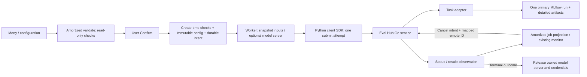

# Eval Hub execution engine

Amortized keeps requirement gathering, lineage and producer checks, warning
acknowledgment, confirmation, resource admission, job IDs, and Studio's job UI.
After Confirm creates a job, the worker prepares inputs and uses the Eval Hub
Python client SDK to submit it. The Hub Go service launches the evaluator,
owns its outcome, and receives its authoritative results. There is no evaluator
bridge pod and no user-facing engine selector.

With Hub on, every new evaluation runs through Hub except a classifier head trained
with `use_peft`: it needs a GPU and Hub's task adapter runs on CPU only, so it
evaluates natively on a GPU. With `evalhub.acceptNewJobs: false` or no `evalhub.url`,
new evaluations run natively.

## Request and execution flow



Validation never creates a Hub job or staging/serving resources. Task definitions
extend existing validation; they do not bypass readiness, embedding/model
compatibility, warning, prompt-reference, or GPU-budget checks. Referenced training
jobs must be succeeded.

The worker uses a database advisory lock per job. Submission state is committed
before POST, with SDK retries disabled. A connect error or connect timeout sent
nothing, so the job returns to `ready` and is submitted again; a request that
cannot be built or sent (validation, insecure saved origin) fails the job. If the
response is lost or a worker dies, it lists Hub jobs by the exact Amortized
correlation name and tag, with pagination and tenant matching. A single exact
match is adopted. Zero or several matches leave the outcome uncertain and never
resubmit, rather than risk a second paid evaluation. Cancel then ends the job as
cancelled, even with no match, several matches or Hub unreachable. After
`AMORTIZED_EVALHUB_UNCERTAIN_TIMEOUT` (default 900 s) the job fails ("Eval Hub did
not confirm the submission within N seconds"). Either way, cleanup reconciles once
more and cancels any Hub job that turned up under the correlation name.

Cancel persists intent first, forwards it when a remote ID is known, and retries
while synchronizing. Studio shows cancellation pending until Hub reports its
actual outcome. Completion may win the race. Read/transport failures set a
synchronization notice and preserve the last observed outcome. Cleanup is retried
without changing a completed evaluation's verdict; GPU admission remains held
until owned serving has stopped. Deletion is blocked while cleanup is pending.

## Supported recipes

A task dataset is scored by the rubric judge; an embedding model by its anchor/query
metrics. Rubric and anchor/query requests keep their existing shape, and an omitted
`evaluation` field selects these task semantics. An explicit task definition only
maps the dataset's columns:

```json
{
  "endpoint": {"base_url": "https://model.example/v1", "model": "candidate"},
  "eval_data_run_id": "<real dataset run>",
  "evaluation": {"kind": "task", "version": "1", "input_column": "question", "reference_column": "expected"},
  "rubric": [{"name": "accuracy", "description": "Facts match the reference"}],
  "judge": {"base_url": "https://judge.example/v1", "model": "judge"}
}
```

The judge scores each answer from 0 to 10 on every approved criterion, against the
reference. Each criterion's metric is the mean divided by 10 (0–1, higher is
better); an answer the judge can't score is left out of the mean and counted as
invalid. There are no fixed scorers (exact match, JSON schema, numeric): the skills
are general-purpose, so a task is judged on its approved rubric. No scorer executes
user-supplied Python. The embedding adapter calls the existing anchor/query
implementation, retaining its splits, seeds, parameters, confusion matrix, and
separability-proxy interpretation.

`GET /api/v1/evaluations/providers` (`list_evaluation_providers` in MCP) reports
whether Hub is enabled and task scoring (503 when Hub or the task provider cannot
be read).

## Components and images

| Component | Image/library | Lifetime |
|---|---|---|
| Amortized server/worker | Existing server image + `eval-hub-sdk[client]==1.0.7` | Existing service |
| Hub API/orchestrator | `quay.io/evalhub/evalhub:1.0.3`, pinned by deployment digest | Persistent operator-managed service |
| Runtime sidecar and input initializer | Matching Hub image, helper commands | Per evaluation |
| Task adapter | `ghcr.io/amortized-ai/evalhub-adapter@sha256:...` built from this source | Per task evaluation |
| Local model preparation/server | Existing eval image; evaluator command removed | Owned lease per locally served model |

The adapter SDK is a library inside adapter images. The task image installs CPU
Torch for embedding evaluation, not vLLM/CUDA training. Existing SDG and training
images remain independent. Native eval uses the same shared generation/scoring
module during migration; its Docker build context is now the repository root.

## Deployment and activation

The default URL is empty so installing this change does not switch a running
environment before its Hub service and providers exist. Connect to an existing
compatible Hub or use the optional Helm `EvalHub` CR/provider ConfigMaps. This
chart does not install a cluster-wide operator.

1. Build server, Studio, eval preparation and task-adapter images from this branch.
   The container workflow includes `build-evalhub-adapter`. Pin image digests.
2. Install/reuse a compatible TrustyAI Service Operator. Its image resolver controls
   the Go server and matching sidecar/init image; pin those together to the tested
   release using the operator's image configuration (`evalHubImage`). Do not assume
   an arbitrary preinstalled operator release provides this contract.
3. Provision a separate persistent PostgreSQL database for Hub (existing PostgreSQL
   infrastructure may host it). Put its URL in a `db-url` Secret in the Hub instance
   namespace. Amortized's migration never creates or mutates the Hub schema.
4. Register the task provider with an immutable image reference. The chart's
   `evalhub.operator.createProviders` writes a system provider ConfigMap to the
   explicitly configured operator namespace.
   This requires deployment privileges there. Keep provider IDs/configuration
   immutable while evaluations are active; create a new provider ID/release for
   a changed protocol rather than mutating a running request's implementation.
5. Configure the Hub service's authenticated HTTPS URL, Amortized's SA token path and
   CA ConfigMap, and set `evalhub.operator.name` to the Hub's name. Hub's tenant is the
   compute namespace, never a browser-supplied value. The operator provisions tenant
   runtime RBAC and helper service accounts. Label a pre-existing jobs namespace
   `evalhub.trustyai.opendatahub.io/tenant=true`; chart-created namespaces receive that
   label when the URL is set.
   - The Hub is multi-tenant, so it lives in a namespace of its own. The operator won't
     run a multi-tenant Hub in a tenant namespace (`InvalidPlacement`), and the chart
     refuses `evalhub.operator.namespace` equal to `namespace` or `jobsNamespace`.
   - The chart creates the Role `amortized-evalhub-user` in the jobs namespace, with
     the operator's tenant user rules, and binds Amortized's service account to it.
     Operator releases differ in the user Role they create there; RHOAI 3.5.3 creates
     none. Installing the chart needs those permissions.
6. Reuse MLflow and S3/MinIO where compatible. The staging bucket must already exist.
   Its S3 connection Secret must exist in the jobs namespace. Hub's initializer
   expects `AWS_ACCESS_KEY_ID`, `AWS_SECRET_ACCESS_KEY`, `AWS_S3_ENDPOINT` and region;
   the chart's `amortized-s3` Secret provides them. Preparation streams MLflow
   artifacts using existing auth/workspace/CA support, hashes them, and writes a
   job-specific immutable S3 snapshot plus manifest. It never forwards `runs:/`,
   `mlflow-artifacts:/`, or Amortized pod-local paths to an evaluator.
7. Use an https MLflow with workspaces. Hub saves every evaluation into the MLflow
   workspace named after the jobs namespace, and Amortized must use the same one:
   set `mlflow.enterprise.enabled: true`, which sets `AMORTIZED_MLFLOW_TRACKING_TOKEN_FILE`
   and `AMORTIZED_MLFLOW_WORKSPACE` (= `jobsNamespace`). Do this even when the MLflow
   has no login, because Amortized sends the workspace only with the token. Without
   both settings, validation refuses every Hub evaluation and says the server must
   change. Otherwise the evaluation would score and then fail at Hub's final save
   (`FEATURE_DISABLED`).
   - RHOAI's operator-managed MLflow meets this.
   - The chart's bundled MLflow doesn't: it runs without `--enable-workspaces`, and
     `mlflow.enterprise.enabled` turns it off.
   - The shared KIND MLflow doesn't either. The KIND live tests used a separate MLflow
     started with `--enable-workspaces` (`mlflow-ws`); turning workspaces on in the
     shared one is a separate amortized-kind-deploy change.

   For RHOAI, also configure the Hub operator's MLflow TLS/workspace/auth integration
   and include the actual helper/adapter SA in `evalhub.operator.jobServiceAccount`
   so the chart grants existing workspace roles. Verify the workspace, CA and rotating
   SA tokens end to end; Amortized's own bindings alone do not grant access to Hub's
   new service accounts.
8. Verify network policy permits authenticated Amortized→Hub, runtime callbacks,
   artifact/staging access, model endpoint access and optional judge access.
   Workload loopback addresses are rejected as external endpoints. Adapter caches
   are writable for arbitrary OpenShift UIDs. GPU serving stays under Amortized's
   existing namespace budget; adapters remain CPU-only.
   HTTPS model and judge endpoints may use a certificate signed by the cluster CA in
   `evalhub.caConfigMap` (on OpenShift, the service CA that signs in-cluster model
   servers): Amortized adds that CA to the model secret as `ca_cert`. Hub's sidecar
   proxies both the model and the judge calls, and trusts `ca_cert` on top of the
   system CAs.
9. Run the cluster smoke test below before enabling the URL for production traffic.

Example connection values (substitute real namespaces, URLs and published digest):

```yaml
evalhub:
  url: https://evalhub.amortized-evalhub.svc:8443
  caConfigMap: openshift-service-ca.crt
  stagingBucket: amortized
  operator:
    createInstance: true
    name: evalhub
    namespace: amortized-evalhub         # the Hub's own namespace, not jobsNamespace
    databaseSecret: evalhub-db           # in amortized-evalhub
    createProviders: true
    namespaceForProviders: trustyai-system
    taskAdapterImage: ghcr.io/amortized-ai/evalhub-adapter@sha256:<published digest>
    jobServiceAccount: evalhub-amortized-evalhub-job   # <name>-<namespace>-job
```


Native Anthropic authentication is currently rejected on the Hub path: the
reviewed credential proxy injects Authorization bearer/basic auth, not Anthropic's
`x-api-key`. Route that provider through an OpenAI-compatible gateway. Existing
native executions retain native Anthropic support. Legacy paired-endpoint configs
remain readable; submit one model per new Hub evaluation. These checks fail before
confirmation rather than accepting an evaluation that cannot authenticate.

## Verification and staged rollout

Local contract tests cover approval-only validation, transactional intent,
ambiguous POST recovery, restart adoption, pagination/tenant matching, cancellation
races, status outages, serving lease recovery, credential erasure, rubric score
math, adapter artifacts, raw units and comparison identity.
They do **not** establish Kubernetes/operator/image/endpoint compatibility.

The cluster release check must run the exact pinned images against a small real
rubric task and an embedding task through the normal Amortized
validate → user Confirm path. Verify outputs/sample artifacts and the single
primary MLflow run, cancel a genuinely running evaluation, restart Amortized
between POST and observation, and check that serving/credential resources are
eventually removed. Confirm MLflow TLS/workspace behavior and namespace isolation.
Keep the URL disabled until this passes in the target environment. No cluster
deployment or live paid evaluation is performed by the unit tests.

Historical jobs retain `execution_owner=native`; new jobs select their owner at
creation. To turn Hub off, first set `evalhub.acceptNewJobs: false`. New evaluations
then run natively and `list_evaluation_providers` reports `enabled: false`, so Morty
offers no benchmarks, while evaluations already on Hub are still observed and
cancelled to completion. Wait until no Hub evaluation is running
(`SELECT count(*) FROM evalhub_executions WHERE state <> 'finished'` returns 0),
then clear `evalhub.url`. Clearing it drops the `amortized-evalhub-user`
Role/RoleBinding, the Hub CA mount, the tenant label and every `AMORTIZED_EVALHUB_*`
setting, and switches `AMORTIZED_MLFLOW_WORKSPACE`, so Amortized can no longer reach
Hub. A Hub evaluation still open at that point fails ("Eval Hub is no longer
configured on this server…") instead of retrying forever: Amortized makes no Hub
call, stops the model server it started, deletes the credential Secret and staged
inputs, and does not cancel anything left on Hub. Likewise, preserve the migration's
outbox table and run this version's worker until in-flight Hub executions and
cleanup finish before rolling the application back to a version that does not
understand those mappings.

Hub metrics/outcomes and MLflow/OCI artifacts are authoritative execution outputs.
Amortized's timestamped snapshot is a disposable UI projection; restoring it must
not launch another evaluation. Task comparison groups include dataset content
hash, rubric/mapping/settings, the provider id, the adapter digest and the provider's
task entry; they exclude timestamps, resource limits, descriptions, per-job object
prefixes and model checkpoint paths. An adapter image change still splits a group.
Raw units and direction remain attached to the metric.
