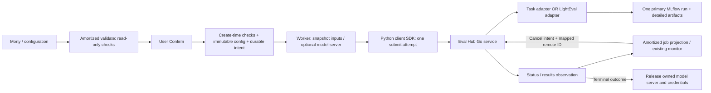

# Eval Hub execution engine

Amortized keeps requirement gathering, lineage and producer checks, warning
acknowledgment, confirmation, resource admission, job IDs, and Studio's job UI.
After Confirm creates a job, the worker prepares inputs and uses the Eval Hub
Python client SDK to submit it. The Hub Go service launches the evaluator,
owns its outcome, and receives its authoritative results. There is no evaluator
bridge pod and no user-facing engine selector.

## Request and execution flow



Validation never creates a Hub job or staging/serving resources. Task definitions
extend existing validation; they do not bypass readiness, embedding/model
compatibility, warning, prompt-reference, or GPU-budget checks. Referenced training
jobs must be succeeded even when the benchmark supplies its own dataset.

The worker uses a database advisory lock per job. Submission state is committed
before POST, with SDK retries disabled. If the response is lost or a worker dies,
it lists Hub jobs by the exact Amortized correlation name and tag, with pagination
and tenant matching. A single exact match is adopted. Zero matches leave the
outcome uncertain; multiple matches require operator reconciliation. Neither case
automatically resubmits. This chooses an explicit unresolved handoff over a second
paid evaluation. Resolve an uncertain intent only after checking Hub and its
persisted store; do not reset its state to `ready` based on an empty list.

Cancel persists intent first, forwards it when a remote ID is known, and retries
while synchronizing. Studio shows cancellation pending until Hub reports its
actual outcome. Completion may win the race. Read/transport failures set a
synchronization notice and preserve the last observed outcome. Cleanup is retried
without changing a completed evaluation's verdict; GPU admission remains held
until owned serving has stopped. Deletion is blocked while cleanup is pending.

## Supported recipes

Existing rubric and anchor/query requests retain their existing shape. An omitted
`evaluation` field selects the existing task semantics. New explicit definitions:

```json
{
  "endpoint": {"base_url": "https://model.example/v1", "model": "candidate"},
  "eval_data_run_id": "<real dataset run>",
  "evaluation": {
    "kind": "task",
    "version": "1",
    "input_column": "question",
    "reference_column": "expected",
    "scorers": [
      {"id": "numeric_mae", "version": "1", "name": "absolute_error"},
      {"id": "numeric_tolerance", "version": "1", "name": "within_two", "tolerance": 2}
    ]
  }
}
```

Implemented deterministic scorer IDs are `exact_match`, `json_schema`,
`numeric_mae`, and `numeric_tolerance`, all version `1`. `response_field` and
`reference_field` optionally extract dot-separated JSON fields. `json_schema`
requires a `schema` object. No scorer executes user-supplied Python.

MAE is lower-is-better in reference units. Invalid numeric values are excluded
with explicit counts and denominators; no observations produce null, never a
fabricated zero. Pass/fail scorers count invalid outputs as zero and expose their
invalid counts. A task may also include approved `rubric` criteria and an explicit
`judge`; deterministic and judge metrics use the same generated answer. Rubric
scores retain the existing normalized 0–1 semantics. The embedding adapter calls
the existing anchor/query implementation, retaining its splits, seeds, parameters,
confusion matrix, and separability-proxy interpretation.

Benchmarks come from **Eval Hub's own lm-eval and LightEval catalogs**, vendored
verbatim at a pinned commit in `deploy/helm/amortized/files/evalhub/`
(`lm_evaluation_harness.yaml`, `lighteval.yaml`; `make evalhub-catalog`). The chart
registers them as `amortized-lm-eval` (offered first) and `amortized-lighteval`,
replacing only the id and runtime so the pinned adapter images run. One benchmark
per job; suites are not supported yet.

Each benchmark's contract (what it needs, what it reports, which metric is its
score) is built per pinned adapter image, for lm-eval and LightEval alike, in three
release steps. Re-run them whenever an image pin or a catalog commit changes:

1. `make evalhub-describe` runs `scripts/evalhub/{lm_eval,lighteval}_compat.py`
   **inside the pinned adapter image** (no GPU) and writes `files/evalhub/described/`:
   resolved tasks, scoring (`generative`, or `likelihood` when any metric needs
   log-probabilities), datasets, settings profile, each metric's direction and, when a
   task config lists its own worked examples, how many (`max_few_shot`; BBH's
   chain-of-thought tasks have 3, so their few-shot default is 3, not the catalog's 5).
   Anything it cannot establish is `unknown` with a reason.
2. `make evalhub-conform` runs every entry a served model can take through Eval Hub
   on a running deployment (KIND or OpenShift), the way a user's job runs (`amortized.integrations.evalhub.conformance`,
   in the server pod, ~10 questions each), and records in
   `files/evalhub/conformance/` what each adapter really reported: metric names and
   values, `additional_info`, MLflow `overall_score`, or why the run failed.
3. `make evalhub-contract` picks each score from the reported names (the catalog's
   metric, then the adapter's prefixed name, a known alias, the only metric
   reported, else no score with the reason) and writes `files/evalhub/compat/`,
   `files/evalhub/REPORT.md` (one row per entry) and Studio's test fixture. It
   stops if the card, Hub, MLflow and the results API disagree on any score.

Only entries verified on the pinned digest are offered; the rest are `unknown` with
the reason. Two entries are offered as one benchmark only when they ask the same
questions *and* score them the same way (confirmed in `contract.SAME_SCORING`).
The chart mounts the compat files into the server and refuses to render if they
describe a different image than the pinned one; at runtime a digest mismatch makes
every entry `unknown`. CI checks that the files are what the evidence builds. How
to run the steps: [Rebuilding the benchmark contract](#rebuilding-the-benchmark-contract).

Compatibility is decided from the model before anything is shown. A model
Amortized serves (`training_job_id`, `model_name_or_path`) supports chat and
`/v1/completions` with logprobs. An outside `endpoint` supports chat, plus
`completions_logprobs` only when the user declares it
(`evaluation.declared_capabilities`). Likelihood benchmarks are hidden for a
chat-only endpoint, and the hidden counts are reported.

Morty uses two read-only tools, never a provider list:

- `find_benchmarks` (`POST /api/v1/evaluations/benchmarks/find`) looks a benchmark
  up by exact normalized name, or browses. Browsing asks one question at a time in
  the fixed order area → kind → provider, picking the first that splits the list.
  Four or fewer choices come back as a card (`present_options`); more come back as
  a typed question. The user's reply goes back as `answer` with the returned
  `picks`; an off-list reply is a 422 listing the allowed values. Hub collections
  are offered as shortlists at the first question, for navigation only.
- `get_benchmark` (`POST /api/v1/evaluations/benchmarks/get`) returns one entry's
  details, compatibility and the only settings the user may change, with bounds and
  defaults.

```json
{
  "endpoint": {"base_url": "https://model.example/v1", "model": "candidate"},
  "evaluation": {
    "kind": "benchmark",
    "provider_id": "amortized-lighteval",
    "benchmark_id": "gsm8k",
    "parameters": {"max_samples": 200}
  }
}
```

Allowed LightEval settings are sample count, few-shot count (0–50) and batch size
(1–64). Few-shot defaults to the catalog's value (GSM8K 8, otherwise 0) and is
sent explicitly, because Hub copies only request parameters to the adapter.
`save_sample_results` is fixed to `false` and no `exports` are sent: the pinned
adapter requires an OCI export for per-question results, and no registry is
configured yet, so benchmarks store aggregate scores only. Code-loading flags,
in-adapter GPU backends, secrets, dataset-revision overrides, custom data and a
random seed are rejected.

**Recipe pinning.** `validate_eval_job` resolves the exact recipe (catalog entry,
adapter image digest, compatibility record, settings, dataset revisions), writes the
resolved settings and a 12-character `recipe_fingerprint` into the card's config,
and returns the server's name, metric, few-shot count, question count and
fingerprint for the card. `create_eval_job` resolves the recipe again and refuses a
card whose fingerprint changed (422, re-validate); otherwise it stores the recipe,
ignoring any recipe a client sent. Before submitting to Hub, preparation builds the
benchmark from that stored recipe and stops if the registered adapter image is no
longer the approved digest. The fingerprint leaves out how the model was served, so
a base endpoint and a tuned model share one comparison group.

`GET /api/v1/evaluations/providers` (`list_evaluation_providers` in MCP) reports
whether Hub is enabled, task scoring and benchmark provider counts; it no longer
lists benchmarks.

## Rebuilding the benchmark contract

The contract describes the providers that are already set up (`amortized-lm-eval`,
`amortized-lighteval`). What to run depends on what changed:

| What changed | Example | Run | Why |
|---|---|---|---|
| An adapter image pin (`evalhub.operator.lmEvalImage` or `lightEvalImage`) | lm-eval moves from `odh-3.6.0` to a newer image | describe, conform, contract | the new image may name metrics differently or fail on tasks that ran before |
| The catalog commit (`EVALHUB_CATALOG_COMMIT`) | upstream Eval Hub adds 20 benchmarks | `make evalhub-catalog`, then describe, conform, contract | the new entries have never run |
| How Amortized scores or shows results (`results.present()`, the card) | a new field in the results view | `make evalhub-contract` only (no GPU) | the evidence is still valid; only the Studio fixture and REPORT.md are rebuilt |
| A new provider (another framework) | a third evaluation framework next to lm-eval and LightEval | one-time setup first ([Adding a provider](#adding-a-provider)), then describe, conform, contract | nothing describes or names its metrics yet |

Nothing needs to run when users run benchmarks, or when other server or Studio code
changes. CI fails when the files no longer match the pins, the catalog or the code,
so it tells you when a rebuild is due.

**Before you start.** `make evalhub-conform` drives a running deployment, so you
need one where:

- the server image contains this checkout's `amortized.integrations.evalhub`
  (the runner runs inside the server pod);
- Hub registers the adapter images you pinned (provider ConfigMaps, step 4 of
  [Deployment and activation](#deployment-and-activation)). Hub reads providers only
  when it starts, so recreate its pod after changing them;
- one GPU is free in the jobs namespace: the runner serves the model there for the
  whole run, so users' GPU jobs wait meanwhile.

**Run it** from the repository root, with the dev environment active. On the KIND
devbox, run from the `evalhub-test/` checkout:

```bash
make evalhub-describe        # no GPU; needs network and docker
make evalhub-conform EVALHUB_KUBECTL="kubectl --context kind-amortized -n amortized-xyang"
make evalhub-contract
pytest tests/test_evalhub_contract.py tests/test_evalhub_catalog.py
(cd studio && npm test)
```

Run `evalhub-conform` detached, so a dropped SSH session doesn't stop it:

```bash
setsid nohup make evalhub-conform EVALHUB_KUBECTL="..." > conform.log 2>&1 < /dev/null &
```

Each Hub job logs one line per entry, for example
`[4] pile_arxiv: failed, 0 metrics, 200 s Evaluation failed: The repository for EleutherAI/pile contains custom code ...`.

**Options**, passed as `EVALHUB_CONFORM_ARGS="..."`:

| Option | Default | Use |
|---|---|---|
| `--only a,b` | all | run only these entry ids (both providers' ids may be mixed) |
| `--limit N` | 0 = all | run at most N entries |
| `--rerun` | off | run entries that already have a result (with `--only` to retry a few) |
| `--questions N` | 10 | questions per entry; 0 = all of them |
| `--chunk N` | 8 | entries per Hub job; Hub starts one adapter pod per entry at once |
| `--model ID` | `Qwen/Qwen3-0.6B` | the model to serve |
| `--timeout S` | 2400 | seconds before a Hub job is cancelled and its open entries recorded as `timed_out` |

**Stopping and resuming.** Results are saved after every Hub job, in the server pod
(`/data/conformance/<provider>.json`) and copied back to `files/evalhub/conformance/`
when the command ends. Run the same command again to continue; recorded entries are
skipped. The record is discarded, and every entry runs again, when the adapter
digest or the model changes. Only one run per provider at a time.

**An entry that needs more questions.** Each entry's record keeps the question count
it ran with, so one entry can run again with another count without touching the
rest. For example, `tinyTruthfulQA` fails with 10 questions ("index 10 is out of
bounds") because its scoring needs all 100. Run it again with all its questions:

```bash
make evalhub-conform EVALHUB_KUBECTL="..." EVALHUB_PROVIDERS=amortized-lm-eval \
  EVALHUB_CONFORM_ARGS="--only tinyTruthfulQA --rerun --questions 0"
```

`REPORT.md` then shows it as `yes (all questions)`, and its card in the Studio
fixture has no question limit.

**How long it takes** (2026-11-09, KIND devbox, Qwen/Qwen3-0.6B, 10 questions per entry):

- the full run: 146 entries in 26 minutes (133 lm-eval in 15, 13 LightEval in 11;
  the pilot's 15 were already on record);
- starting the model server: 2.5 minutes per provider (5 the first time, pulling the image);
- a Hub job of 8 entries: 30 to 45 seconds once the adapter image is on the node,
  2.5 minutes more on first use. A Hub job lasts as long as its slowest entry; LightEval
  jobs with `aime24`, `aime25` or `lcb:codegeneration_v6`, which generate long answers,
  take about 5 minutes;
- re-running entries whose score the adapter names differently: under a minute.

**Review and commit.** `make evalhub-contract` stops with a list of problems if the
card, Hub, MLflow and the results API disagree on any score, or if `SAME_SCORING`
names entries that no longer ask the same questions. Otherwise, read the diff of
`files/evalhub/REPORT.md`: one row per entry with whether it runs (or why not), its
score and why, its copies and the suites that contain it. Commit together:
`files/evalhub/{described,conformance,compat}/`, `files/evalhub/REPORT.md` and
`studio/src/test/fixtures/evalhub-results.json`. Then redeploy the chart, so the
server mounts the new files (ConfigMap `amortized-evalhub-compat`).

### Adding a provider

The commands work per provider, but each framework needs a one-time setup so they
know how to read its tasks and its metric names. For a provider `amortized-<x>`:

1. **Its catalog.** Add its Eval Hub catalog file to `make evalhub-catalog` (the
   `for name in ...` list), so it is vendored at `EVALHUB_CATALOG_COMMIT` like the
   other two.
2. **A describe helper.** Write `scripts/evalhub/<x>_compat.py`, which runs inside
   the pinned adapter image and writes `described/amortized-<x>.json` with schema
   `amortized.evalhub.described/v1`: per entry its tasks, datasets, scoring, settings
   profile and metric directions, or `unknown` with a reason. Copy
   `lm_eval_compat.py`; add an `evalhub-describe-<x>` target and its image variable
   to the Makefile.
3. **A settings profile**: what users may change and what the model must support.
   - its parameter model goes in `catalog.SETTINGS_PROFILES` and
     `evaluation/spec.py`;
   - its model needs (for example completions with logprobs) go in
     `catalog._PROFILE_NEEDS`;
   - if its adapter needs the model's tokenizer, add it to
     `preparation.needs_tokenizer`.
4. **Registration.** Add the id to:
   - `EVALHUB_PROVIDERS` (Makefile) and `contract.CATALOGS`;
   - the chart: the Hub `providers` list and a provider entry in
     `templates/evalhub.yaml`, `values.yaml` `providers` and its image value;
   - `config.evalhub_providers`.

   The provider entry's `entrypoint` must run the adapter's main script through
   `files/evalhub/adapter_launcher.py`, as the two existing entries do. Where the
   script and its Python live differs per image.

   The order of `providers` decides which copy Morty offers first.
5. **Its metric names, if it renames them.** The score rule matches the catalog's
   metric against the names the adapter reports. If the adapter prefixes the task
   (LightEval reports `arc:easy.acc` for `acc`), add its settings profile to
   `contract.PREFIXED`. If it uses other names for the same metric (LightEval's
   `mcc` for `matthews_correlation`), add them to `contract.ALIASES`. When unsure,
   run conform first: REPORT.md shows every entry whose score was not found and the
   names the adapter reported instead.
6. **Copies.** If an entry asks the same questions as another provider's entry and
   scores them the same way, list the pair in `contract.SAME_SCORING`; otherwise both
   are offered separately.

Then run describe, conform and contract as above. The launcher's code needs no
change: it reads the score metric from the Hub job, whatever the framework.

## Components and images

| Component | Image/library | Lifetime |
|---|---|---|
| Amortized server/worker | Existing server image + `eval-hub-sdk[client]==1.0.7` | Existing service |
| Hub API/orchestrator | `quay.io/evalhub/evalhub:1.0.3`, pinned by deployment digest | Persistent operator-managed service |
| Runtime sidecar and input initializer | Matching Hub image, helper commands | Per evaluation |
| Task adapter | `ghcr.io/amortized-ai/evalhub-adapter@sha256:...` built from this source | Per task evaluation |
| Benchmark adapter | Pinned `quay.io/evalhub/community-lighteval@sha256:...` | Per benchmark evaluation |
| Local model preparation/server | Existing eval image; evaluator command removed | Owned lease per locally served model |

The adapter SDK is a library inside adapter images. The task image installs CPU
Torch for embedding evaluation, not vLLM/CUDA training. Existing SDG and training
images remain independent. Native eval uses the same shared generation/scoring
module during migration; its Docker build context is now the repository root.

## Deployment and activation

The default URL is empty so installing this change does not switch a running
environment before its Hub service and providers exist. Connect to an existing
compatible Hub or use the optional Helm `EvalHub` CR/provider ConfigMaps. This
chart does not install a cluster-wide operator.

1. Build server, Studio, eval preparation and task-adapter images from this branch.
   The container workflow includes `build-evalhub-adapter`. Pin image digests.
2. Install/reuse a compatible TrustyAI Service Operator. Its image resolver controls
   the Go server and matching sidecar/init image; pin those together to the tested
   release using the operator's image configuration (`evalHubImage`). Do not assume
   an arbitrary preinstalled operator release provides this contract.
3. Provision a separate persistent PostgreSQL database for Hub (existing PostgreSQL
   infrastructure may host it). Put its URL in a `db-url` Secret in the Hub instance
   namespace. Amortized's migration never creates or mutates the Hub schema.
4. Register the task and benchmark providers with immutable image references. The
   chart's `evalhub.operator.createProviders` writes system provider ConfigMaps to
   the explicitly configured operator namespace using distinct provider names.
   This requires deployment privileges there. Keep provider IDs/configuration
   immutable while evaluations are active; create a new provider ID/release for
   a changed protocol rather than mutating a running request's implementation.
5. Configure the Hub service's authenticated HTTPS URL, Amortized's SA token path,
   CA ConfigMap and tenant API RoleBinding. Hub's tenant is the compute namespace,
   never a browser-supplied value. The operator provisions tenant runtime RBAC and
   helper service accounts. Label a pre-existing jobs namespace
   `evalhub.trustyai.opendatahub.io/tenant=true` when using multi-tenancy; chart-created
   namespaces receive that label when the URL is set.
6. Reuse MLflow and S3/MinIO where compatible. The staging bucket must already exist.
   Its S3 connection Secret must exist in the jobs namespace. Hub's initializer
   expects `AWS_ACCESS_KEY_ID`, `AWS_SECRET_ACCESS_KEY`, `AWS_S3_ENDPOINT` and region;
   the chart's `amortized-s3` Secret provides them. Preparation streams MLflow
   artifacts using existing auth/workspace/CA support, hashes them, and writes a
   job-specific immutable S3 snapshot plus manifest. It never forwards `runs:/`,
   `mlflow-artifacts:/`, or Amortized pod-local paths to an evaluator.
7. For enterprise MLflow, configure the Hub operator's MLflow TLS/workspace/auth
   integration and include the actual helper/adapter SA in
   `evalhub.operator.jobServiceAccount` so the chart grants existing workspace roles.
   Hub uses the tenant namespace as the execution workspace. Verify the configured
   workspace, CA and rotating SA tokens end to end; Amortized's own bindings alone
   do not grant access to Hub's new service accounts.
8. Verify network policy permits authenticated Amortized→Hub, runtime callbacks,
   artifact/staging access, model endpoint access and optional judge access.
   Workload loopback addresses are rejected as external endpoints. Adapter caches
   are writable for arbitrary OpenShift UIDs. GPU serving stays under Amortized's
   existing namespace budget; adapters remain CPU-only.
9. Run the cluster smoke test below before enabling the URL for production traffic.

Example connection values (substitute real namespaces, URLs and published digest):

```yaml
evalhub:
  url: https://evalhub.amortized-jobs.svc:8443
  caConfigMap: openshift-service-ca.crt
  stagingBucket: amortized
  providers: [amortized-lighteval]
  operator:
    createInstance: true
    namespace: amortized-jobs
    databaseSecret: evalhub-db
    createProviders: true
    namespaceForProviders: trustyai-system
    taskAdapterImage: ghcr.io/amortized-ai/evalhub-adapter@sha256:<published digest>
    jobServiceAccount: evalhub-amortized-jobs-job
```

Native Anthropic authentication is currently rejected on the Hub path: the
reviewed credential proxy injects Authorization bearer/basic auth, not Anthropic's
`x-api-key`. Route that provider through an OpenAI-compatible gateway. Existing
native executions retain native Anthropic support. Legacy paired-endpoint configs
remain readable; submit one model per new Hub evaluation. These checks fail before
confirmation rather than accepting an evaluation that cannot authenticate.

## Verification and staged rollout

Local contract tests cover approval-only validation, transactional intent,
ambiguous POST recovery, restart adoption, pagination/tenant matching, cancellation
races, status outages, serving lease recovery, credential erasure, scorer math,
hybrid generation reuse, adapter artifacts, raw units and comparison identity.
They do **not** establish Kubernetes/operator/image/endpoint compatibility.

The cluster release check must run the exact pinned images against a small real
task, a rubric/hybrid task, an embedding task, GSM8K (generative) and one
likelihood benchmark on a served model (e.g. ARC challenge) through the normal Amortized
validate → user Confirm path. Verify outputs/sample artifacts and the single
primary MLflow run, cancel a genuinely running evaluation, restart Amortized
between POST and observation, and check that serving/credential resources are
eventually removed. Confirm MLflow TLS/workspace behavior and namespace isolation.
Keep the URL disabled until this passes in the target environment. No cluster
deployment or live paid evaluation is performed by the unit tests.

Historical jobs retain `execution_owner=native`; new jobs select their owner at
creation. Unsetting the URL stops new Hub requests but does not rewrite accepted
jobs or abandon their recovery: observation and cancellation use their saved Hub
URL/tenant. Preserve the migration's outbox table and run this version's worker
until in-flight Hub executions and cleanup finish before rolling the application
back to a version that does not understand those mappings.

Hub metrics/outcomes and MLflow/OCI artifacts are authoritative execution outputs.
Amortized's timestamped snapshot is a disposable UI projection; restoring it must
not launch another evaluation. Task comparison groups include dataset content
hash, scorer/rubric/mapping/settings and provider catalog/image identity, while
excluding per-job object prefixes and model checkpoint paths. Benchmark groups key on
the recipe fingerprint alone. Different recipes
stay separate; raw units and direction remain attached to the metric.
